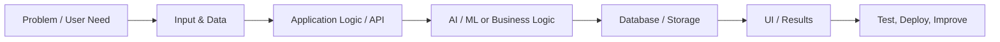

# NIKESH

### AI Engineer · Full-Stack Developer · Computer Vision

**I build AI-powered products, intelligent applications, and data-driven experiences.**

 

---

## Profile

Hi! I'm **Nikesh**, a Computer Science & Engineering (Data Science) student based in India. I enjoy turning ideas into useful software — from AI/ML experiments and computer-vision pipelines to web applications, dashboards, and APIs.

- **Current direction:** AI engineering, full-stack development, and computer vision
- **I like building:** end-to-end products, intelligent tools, data-driven apps, and practical demos
- **Career goal:** build impactful AI products and secure a software engineering role
- **Approach:** learn by building, test ideas, ship useful work, and keep improving

> **Engineering mindset:** Make it useful. Make it reliable. Keep learning.

## Featured builds

<table>
<tr>
<td width="50%" valign="top">

### [EURS AI Studio](https://eurs-ai-studio.vercel.app)
AI image-restoration and semantic-segmentation project interface.

**Focus:** Image processing · AI workflows

[↗ Open demo](https://eurs-ai-studio.vercel.app) · [Source](https://github.com/nvaltryek-001/EURS-ai-studio)

</td>
<td width="50%" valign="top">

### [MarketMind](https://market-mind-zeta-pearl.vercel.app)
Stock-intelligence application exploring market analysis and decision support.

**Focus:** Data-driven insights · Web application

[↗ Open demo](https://market-mind-zeta-pearl.vercel.app) · [Source](https://github.com/nvaltryek-001/MarketMind)

</td>
</tr>
<tr>
<td width="50%" valign="top">

### [Smart College Attendance](https://smart-attendance-demo-1.onrender.com)
Attendance demo built around face-recognition workflows.

**Focus:** Computer vision · Attendance automation

[↗ Open demo](https://smart-attendance-demo-1.onrender.com) · [Source](https://github.com/nvaltryek-001/smart-attendance-demo)

</td>
<td width="50%" valign="top">

### [DataVisionPro](https://datavision-pro-1.onrender.com)
AI-powered analytics dashboard for exploring and presenting data.

**Focus:** Analytics · Dashboard development

[↗ Open demo](https://datavision-pro-1.onrender.com) · [Source](https://github.com/nvaltryek-001/DataVision-Pro)

</td>
</tr>
<tr>
<td width="50%" valign="top">

### [GHARLIST](https://gharlist.netlify.app)
Smart family-shopping assistant for browsing products and preparing shopping lists.

**Focus:** Product discovery · Shopping workflow

[↗ Open demo](https://gharlist.netlify.app) · [Source](https://github.com/nvaltryek-001/GHARLIST)

</td>
<td width="50%" valign="top">

### [Car Price Estimator](https://carpriceestimation-9xuvjxsw3-nvaltryek-001.vercel.app/)
A deployed used-car price estimation application.

**Focus:** Predictive analytics · ML application

[↗ Open demo](https://carpriceestimation-9xuvjxsw3-nvaltryek-001.vercel.app/) · [Source](https://github.com/nvaltryek-001/car-price-estimator)

</td>
</tr>
<tr>
<td width="50%" valign="top">

### [Mall Customer Segmentation](https://mall-customer-segmentation-mn873eb0k-nvaltryek-001.vercel.app/)
Customer-segmentation project focused on data analysis and audience grouping.

**Focus:** Data science · Unsupervised learning

[↗ Open demo](https://mall-customer-segmentation-mn873eb0k-nvaltryek-001.vercel.app/) · [Source](https://github.com/nvaltryek-001/mall-customer-segmentation)

</td>
<td width="50%" valign="top">

### [Apt-IQ](https://apt-iq-alpha.vercel.app)
Aptitude-practice application.

**Focus:** Learning tools · Web development

[↗ Open demo](https://apt-iq-alpha.vercel.app) · [Source](https://github.com/nvaltryek-001/AptIQ)

</td>
</tr>
<tr>
<td width="50%" valign="top">

### [MCQ Platform](https://mcq-r6wr.vercel.app)
Multiple-choice quiz application.

**Focus:** Assessment workflows · Web development

[↗ Open demo](https://mcq-r6wr.vercel.app) · [Source](https://github.com/nvaltryek-001/MCQ)

</td>
<td width="50%" valign="top">

### [Human Battery](https://human-battery.vercel.app)
A deployed web project: energy check-ins, dashboard, and insights.

[↗ Open demo](https://human-battery.vercel.app)

</td>
</tr>
</table>

*Demo links are the URLs supplied for this README; availability may change. Descriptions are concise summaries, not claims of measured performance.*

## Research & other projects

| Project | Overview | Repository |
| --- | --- | --- |
| **ISL Recognition Research** | Indian Sign Language recognition experiments using MediaPipe landmarks and LSTM/GRU sequence models; prior setup includes 45-frame sequences and 50 classes. | [Indian-Sign-Language-Recognition](https://github.com/nvaltryek-001/Indian-Sign-Language-Recognition) |
| **EduLens** | Facial-recognition attendance project exploring InsightFace, OpenCV, ONNX Runtime, and SQLite. | [Edulens](https://github.com/nvaltryek-001/Edulens) |
| **ArtifactScan AI** | 3D artifact digitization and categorization concept using image capture/photogrammetry and AI-assisted descriptions. | [artifactscan-ai](https://github.com/nvaltryek-001/artifactscan-ai) |
| **EngineerOS AI** | AI-focused engineering workspace concept with a React/Vite frontend and Node/Express API work. | [EngineerOS-AI](https://github.com/nvaltryek-001/EngineerOS-AI) |
| **FoodSense AI / Food Ordering** | Food-ordering application. | [Food-Ordering](https://github.com/nvaltryek-001/Food-Ordering) |
| **Valtryek Smart City / CityPulse AI** | Smart-city application concept focused on connected urban services and infrastructure workflows. | [CityPulse-AI](https://github.com/nvaltryek-001/CityPulse-AI) |
| **LeetCode Practice** | Data structures and algorithms practice. | [Leetcode](https://github.com/nvaltryek-001/Leetcode) |

## Technology stack

**Languages**

**AI · Machine Learning · Computer Vision**

**Frontend · Backend · Data**

Technologies shown reflect tools used or explored across these projects; the badges are not a claim of expert-level proficiency in every technology.

## How I build

1. Understand the user problem and define a useful outcome.
2. Build the interface and data/API flow.
3. Add model inference or application logic where it provides value.
4. Validate outputs and handle failure cases.
5. Deploy, observe, and iterate.

*A representative workflow, not a claim that every project uses the same architecture.*

## GitHub signals

Statistics load from third-party services and may be unavailable or differ from GitHub's own interface.

## Achievements & growth

- Building and iterating on AI, computer-vision, analytics, and full-stack projects.
- Practicing DSA patterns and software-engineering fundamentals.
- Exploring model pipelines, APIs, deployment, and end-to-end product engineering.

[View my LinkedIn profile for professional experience, certifications, and updates →](https://www.linkedin.com/in/nikesh-13ab91392/)

## Current focus

- Build practical AI products with clear user value.
- Improve computer-vision and machine-learning workflows.
- Strengthen backend, full-stack, and deployment skills.
- Practice DSA and prepare for software-engineering opportunities.

## Let's connect

**Open to learning, collaboration, and meaningful engineering opportunities.**

  

**Build with purpose · Learn continuously · Ship and improve**

