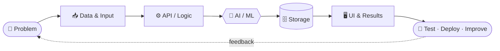

<!-- ═══════════════════════ ANIMATED HEADER ═══════════════════════ -->
<p align="center">
  
</p>

<p align="center">
  
</p>

<p align="center">
  <a href="https://github.com/nvaltryek-001">
    
  </a>
</p>

<p align="center">
  <a href="https://www.linkedin.com/in/nikesh-13ab91392/"></a>
  <a href="mailto:nikeshnikesh32431@gmail.com"></a>
  <a href="https://nvaltryek-001.github.io/nvaltryek-001/"></a>
  <a href="https://github.com/nvaltryek-001?tab=repositories"></a>
  
</p>

---

##  About Me

<table>
<tr>
<td width="58%" valign="top">

```python
class Nikesh:
    def __init__(self):
        self.role       = "AI Engineer & Full-Stack Developer"
        self.education  = "B.E. CSE (Data Science)"
        self.focus      = ["Computer Vision", "Machine Learning",
                           "Full-Stack Development", "Data Analytics"]
        self.building   = "Practical AI products with real user value"
        self.learning   = ["Model pipelines", "Backend & deployment", "DSA"]
        self.goal       = "Software Engineering role → impactful AI products"
        self.motto      = "Learn by building. Ship. Improve."

    def say_hi(self):
        print("Open to collaboration & engineering opportunities 🚀")
```

</td>
<td width="42%" valign="top">

- 🔭 Building **AI + computer-vision** apps end to end
- 🧠 Researching **Indian Sign Language recognition** with MediaPipe + sequence models
- 🌐 Shipping **full-stack** apps on Vercel, Render & Netlify
- 📊 Turning data into **dashboards & insights**
- 🧩 Practicing **DSA** daily on LeetCode
- 💬 Ask me about **OpenCV, React, FastAPI, ML**

</td>
</tr>
</table>

---

## 🛠️ Tech Stack

<p align="center">
  <br/>
  <br/>
  <br/>
  
</p>

<p align="center">
  
  
  
  
  
</p>

---

## 🚀 Featured Projects

<table>
<tr>
<td width="50%" valign="top">

### 🎨 [EURS AI Studio](https://eurs-ai-studio.vercel.app)
AI **image restoration** and **semantic segmentation** studio.

`Computer Vision` `Image Processing` `AI Workflows`

<a href="https://eurs-ai-studio.vercel.app"></a>
<a href="https://github.com/nvaltryek-001/EURS-ai-studio"></a>

</td>
<td width="50%" valign="top">

### 📈 [MarketMind](https://market-mind-zeta-pearl.vercel.app)
**Stock-intelligence** app for market analysis and decision support.

`Data Analytics` `Finance` `Web App`

<a href="https://market-mind-zeta-pearl.vercel.app"></a>
<a href="https://github.com/nvaltryek-001/MarketMind"></a>

</td>
</tr>
<tr>
<td width="50%" valign="top">

### 🧑‍🎓 [Smart College Attendance](https://smart-attendance-demo-1.onrender.com)
**Face-recognition** attendance automation for classrooms.

`Computer Vision` `Face Recognition` `Automation`

<a href="https://smart-attendance-demo-1.onrender.com"></a>
<a href="https://github.com/nvaltryek-001/smart-attendance-demo"></a>

</td>
<td width="50%" valign="top">

### 📊 [DataVisionPro](https://datavision-pro-1.onrender.com/)
**AI-powered analytics dashboard** for exploring and presenting data.

`Analytics` `Dashboards` `Data Viz`

<a href="https://datavision-pro-1.onrender.com/"></a>
<a href="https://github.com/nvaltryek-001/DataVision-Pro"></a>

</td>
</tr>
<tr>
<td width="50%" valign="top">

### 🛒 [GHARLIST](https://gharlist.netlify.app)
Smart **family-shopping assistant** — browse products, build lists.

`Product Discovery` `Web App`

<a href="https://gharlist.netlify.app"></a>
<a href="https://github.com/nvaltryek-001/GHARLIST"></a>

</td>
<td width="50%" valign="top">

### 🚗 [Car Price Estimator](https://carpriceestimation-9xuvjxsw3-nvaltryek-001.vercel.app/)
**ML regression** app that predicts used-car prices.

`Machine Learning` `Predictive Analytics`

<a href="https://carpriceestimation-9xuvjxsw3-nvaltryek-001.vercel.app/"></a>
<a href="https://github.com/nvaltryek-001/car-price-estimator"></a>

</td>
</tr>
<tr>
<td width="50%" valign="top">

### 🛍️ [Mall Customer Segmentation](https://mall-customer-segmentation-mn873eb0k-nvaltryek-001.vercel.app/)
**Unsupervised learning** to group customers into audiences.

`Clustering` `Data Science`

<a href="https://mall-customer-segmentation-mn873eb0k-nvaltryek-001.vercel.app/"></a>
<a href="https://github.com/nvaltryek-001/mall-customer-segmentation"></a>

</td>
<td width="50%" valign="top">

### 🧮 [Apt-IQ](https://apt-iq-alpha.vercel.app)
**Aptitude-practice** platform for placement prep.

`EdTech` `Web Development`

<a href="https://apt-iq-alpha.vercel.app"></a>
<a href="https://github.com/nvaltryek-001/AptIQ"></a>

</td>
</tr>
<tr>
<td width="50%" valign="top">

### 📝 [MCQ Platform](https://mcq-r6wr.vercel.app)
**Multiple-choice quiz** app for assessments.

`Assessment` `Web Development`

<a href="https://mcq-r6wr.vercel.app"></a>
<a href="https://github.com/nvaltryek-001/MCQ"></a>

</td>
<td width="50%" valign="top">

### 🔋 [Human Battery](https://human-battery.vercel.app)
**Energy check-ins**, a personal dashboard and insights.

`Wellbeing` `Dashboard`

<a href="https://human-battery.vercel.app"></a>

</td>
</tr>
</table>

---

## 🔬 Research & Experiments

<details open>
<summary><b>Click to expand / collapse</b></summary>
<br/>

| | Project | What it is | Repo |
|:-:|---|---|:-:|
| 🤟 | **ISL Recognition Research** | Indian Sign Language recognition with MediaPipe landmarks + sequence models | [→](https://github.com/nvaltryek-001/Indian-Sign-Language-Recognition) |
| 👁️ | **EduLens** | Facial-recognition attendance using InsightFace, OpenCV & SQLite | [→](https://github.com/nvaltryek-001/Edulens) |
| 🏺 | **ArtifactScan AI** | 3D artifact digitization + AI-assisted categorization concept | [→](https://github.com/nvaltryek-001/artifactscan-ai) |
| ⚙️ | **EngineerOS AI** | AI-focused engineering workspace with frontend + API | [→](https://github.com/nvaltryek-001/EngineerOS-AI) |
| 🍔 | **FoodSense AI** | Food-ordering application | [→](https://github.com/nvaltryek-001/Food-Ordering) |
| 🏙️ | **CityPulse AI** | Smart-city concept for connected urban services | [→](https://github.com/nvaltryek-001/CityPulse-AI) |
| 🧩 | **LeetCode** | Data structures & algorithms practice | [→](https://github.com/nvaltryek-001/Leetcode) |

</details>

<p align="center"><a href="https://github.com/nvaltryek-001?tab=repositories"><b>➜ Browse all 25+ repositories</b></a></p>

---

## 🧭 How I Build



---

## 📊 GitHub Analytics

<p align="center">
  
  
</p>

<p align="center">
  
</p>

<p align="center">
  
</p>

---

## 🐍 Contribution Snake

<p align="center">
  <picture>
    <source media="(prefers-color-scheme: dark)" srcset="https://raw.githubusercontent.com/nvaltryek-001/nvaltryek-001/output/github-snake-dark.svg" />
    <source media="(prefers-color-scheme: light)" srcset="https://raw.githubusercontent.com/nvaltryek-001/nvaltryek-001/output/github-snake.svg" />
    
  </picture>
</p>

---

## 🎯 Current Focus

<table>
<tr>
<td align="center" width="25%">🤖<br/><b>AI Products</b><br/><sub>Practical tools with clear user value</sub></td>
<td align="center" width="25%">👁️<br/><b>Computer Vision</b><br/><sub>Better CV & ML pipelines</sub></td>
<td align="center" width="25%">🌐<br/><b>Backend & Deploy</b><br/><sub>APIs, infra, production apps</sub></td>
<td align="center" width="25%">🧩<br/><b>DSA</b><br/><sub>Interview-ready fundamentals</sub></td>
</tr>
</table>

---

## 🤝 Let's Connect

<p align="center">
  <b>Open to internships, SDE roles, and collaborations on AI / CV projects.</b><br/><br/>
  <a href="https://www.linkedin.com/in/nikesh-13ab91392/"></a>
  <a href="mailto:nikeshnikesh32431@gmail.com"></a>
  <a href="https://github.com/nvaltryek-001"></a>
</p>

<p align="center">
  
</p>

<!-- ═══════════════════════ ANIMATED FOOTER ═══════════════════════ -->
<p align="center">
  
</p>
