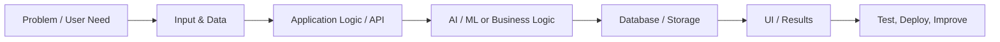

  

# NIKESH

### AI Engineer · Full-Stack Developer · Computer Vision

Building AI-powered products, intelligent applications, and data-driven experiences.

---

## About Me

Hi! I'm **Nikesh**, a Computer Science and Engineering student specializing in Data Science. I enjoy transforming ideas into practical software through AI, machine learning, computer vision, analytics, and full-stack development.

- **Focus:** AI engineering, computer vision, and full-stack development
- **Interests:** Intelligent applications, data-driven products, and software engineering
- **Career goal:** Build impactful AI products and secure a software engineering role
- **Engineering mindset:** Learn by building, test ideas, deploy useful solutions, and continuously improve.

## Featured Projects

<table>
<tr>
<td width="50%" valign="top">

### [EURS AI Studio](https://eurs-ai-studio.vercel.app)

AI image-restoration and semantic-segmentation project interface.

**Focus:** Image processing · AI workflows

[Live Demo](https://eurs-ai-studio.vercel.app) · [Source Code](https://github.com/nvaltryek-001/EURS-ai-studio)

</td>
<td width="50%" valign="top">

### [MarketMind](https://market-mind-zeta-pearl.vercel.app)

Stock-intelligence application exploring market analysis and decision support.

**Focus:** Data-driven insights · Web applications

[Live Demo](https://market-mind-zeta-pearl.vercel.app) · [Source Code](https://github.com/nvaltryek-001/MarketMind)

</td>
</tr>
<tr>
<td width="50%" valign="top">

### [Smart College Attendance](https://smart-attendance-demo-1.onrender.com)

Attendance demo built around face-recognition workflows.

**Focus:** Computer vision · Attendance automation

[Live Demo](https://smart-attendance-demo-1.onrender.com) · [Source Code](https://github.com/nvaltryek-001/smart-attendance-demo)

</td>
<td width="50%" valign="top">

### [DataVisionPro](https://datavision-pro-1.onrender.com/)

AI-powered analytics dashboard for exploring and presenting data.

**Focus:** Analytics · Dashboard development

[Live Demo](https://datavision-pro-1.onrender.com/) · [Source Code](https://github.com/nvaltryek-001/DataVision-Pro)

</td>
</tr>
<tr>
<td width="50%" valign="top">

### [GHARLIST](https://gharlist.netlify.app)

Smart family-shopping assistant for browsing products and preparing shopping lists.

**Focus:** Product discovery · Shopping workflows

[Live Demo](https://gharlist.netlify.app) · [Source Code](https://github.com/nvaltryek-001/GHARLIST)

</td>
<td width="50%" valign="top">

### [Car Price Estimator](https://carpriceestimation-9xuvjxsw3-nvaltryek-001.vercel.app/)

Used-car price estimation application.

**Focus:** Predictive analytics · Machine learning

[Live Demo](https://carpriceestimation-9xuvjxsw3-nvaltryek-001.vercel.app/) · [Source Code](https://github.com/nvaltryek-001/car-price-estimator)

</td>
</tr>
<tr>
<td width="50%" valign="top">

### [Mall Customer Segmentation](https://mall-customer-segmentation-mn873eb0k-nvaltryek-001.vercel.app/)

Customer-segmentation project focused on data analysis and audience grouping.

**Focus:** Data science · Unsupervised learning

[Live Demo](https://mall-customer-segmentation-mn873eb0k-nvaltryek-001.vercel.app/) · [Source Code](https://github.com/nvaltryek-001/mall-customer-segmentation)

</td>
<td width="50%" valign="top">

### [Apt-IQ](https://apt-iq-alpha.vercel.app)

Aptitude-practice application.

**Focus:** Learning tools · Web development

[Live Demo](https://apt-iq-alpha.vercel.app) · [Source Code](https://github.com/nvaltryek-001/AptIQ)

</td>
</tr>
<tr>
<td width="50%" valign="top">

### [MCQ Platform](https://mcq-r6wr.vercel.app)

Multiple-choice quiz application.

**Focus:** Assessment workflows · Web development

[Live Demo](https://mcq-r6wr.vercel.app) · [Source Code](https://github.com/nvaltryek-001/MCQ)

</td>
<td width="50%" valign="top">

### [Human Battery](https://human-battery.vercel.app)

Web application featuring energy check-ins, a dashboard, and insights.

[Live Demo](https://human-battery.vercel.app)

</td>
</tr>
</table>

## Research and Other Projects

| Project | Overview | Repository |
|---|---|---|
| **ISL Recognition Research** | Indian Sign Language recognition using MediaPipe landmarks and sequence models. | [Indian-Sign-Language-Recognition](https://github.com/nvaltryek-001/Indian-Sign-Language-Recognition) |
| **EduLens** | Facial-recognition attendance project exploring InsightFace, OpenCV, and SQLite. | [EduLens](https://github.com/nvaltryek-001/Edulens) |
| **ArtifactScan AI** | 3D artifact digitization and AI-assisted categorization concept. | [ArtifactScan AI](https://github.com/nvaltryek-001/artifactscan-ai) |
| **EngineerOS AI** | AI-focused engineering workspace with frontend and API development. | [EngineerOS AI](https://github.com/nvaltryek-001/EngineerOS-AI) |
| **FoodSense AI / Food Ordering** | Food-ordering application. | [Food Ordering](https://github.com/nvaltryek-001/Food-Ordering) |
| **Valtryek Smart City / CityPulse AI** | Smart-city application concept for connected urban services. | [CityPulse AI](https://github.com/nvaltryek-001/CityPulse-AI) |
| **LeetCode Practice** | Data structures and algorithms practice. | [LeetCode](https://github.com/nvaltryek-001/Leetcode) |

## Technology Stack

**Languages**

**AI, Machine Learning and Computer Vision**

**Frontend, Backend and Data**

*This stack reflects technologies used or explored across my projects, not a claim of expert-level proficiency in every tool.*

## How I Build

My general development workflow:

1. Understand the problem and define the desired outcome.
2. Build the interface and data/API flow.
3. Integrate AI, ML, or application logic where it adds value.
4. Validate outputs and handle failure cases.
5. Deploy, observe, and improve.

*This is a representative workflow; not every project uses the same architecture.*

## GitHub Statistics

*Statistics are provided by third-party services and may occasionally be unavailable.*

## Achievements and Growth

- Building and improving AI, computer-vision, analytics, and full-stack projects.
- Practicing data structures and algorithms and software-engineering fundamentals.
- Exploring model pipelines, APIs, deployment, and end-to-end product development.
- Continuously learning through implementation and experimentation.

For professional experience and certifications, visit my [LinkedIn profile](https://www.linkedin.com/in/nikesh-13ab91392/).

## Current Focus

- Build practical AI products with clear user value.
- Improve computer-vision and machine-learning workflows.
- Strengthen backend, full-stack, and deployment skills.
- Practice DSA and prepare for software-engineering opportunities.

## Let's Connect

**Open to learning, collaboration, and meaningful engineering opportunities.**

**Build with purpose · Learn continuously · Ship and improve**

---

Project descriptions are concise summaries. Demo availability may change; verify links before presenting them to recruiters.
